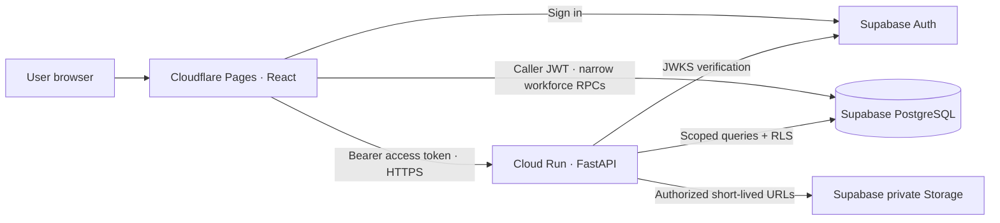

# Architecture

## Current implementation and boundaries

The public React site, login interface, isolated synthetic previews, and FastAPI
health/session boundary run locally. Organization setup and scoped employee
profiles, shift assignments and normal attendance now use Supabase database
functions; corrections/documents remain unimplemented. Authentication uses Supabase Auth plus the
RLS-protected `current_workspace()` RPC. The optional FastAPI membership adapter
calls the same RPC using a verified caller JWT. Missing configuration or assignment
is denied. The owner confirmed live login and workforce screens; the account
gateway has a separate one-time activation. No API returns demo data.



The frontend was reported live at `https://snr-nest.pages.dev`. Google Cloud Run is
paused; the selected Supabase project is `emvppphhkmbpgqduikup`. The authentication
path can run without Cloud Run. An unconfigured/unassigned install grants no private session.
Development `/preview/*` routes import synthetic fixtures only in Vite development
mode. The production route table and bundle omit those imports. The normal `/me`,
`/team`, and `/hr` routes always use the auth gate.

## Request and authentication flow

1. Sign-in email/password goes directly to Supabase over HTTPS. Staff account
   creation and credential edits use the separate authorized Pages gateway below;
   its request credentials are never logged or persisted.
2. The SDK obtains an access token; Auth `getUser` verifies identity against Supabase.
3. With the default `supabase` session source, `current_workspace()` executes in
   PostgreSQL as the authenticated caller under RLS. It accepts no identity/role/org
   arguments and returns only that user's active database assignment. Zero/multiple
   active assignments are denied; no first-user promotion or tenant auto-selection.
4. With explicit `api` source, FastAPI first verifies the asymmetric JWT's issuer,
   audience, expiry and signature, then calls the same RPC with the user's token.
   No service-role key or bypass of RLS is used. Returned user IDs must match.
5. Only a server-confirmed workspace opens. The SDK stores credentials in tab-scoped
   sessionStorage, rechecks membership on restoration/token refresh, and clears
   local credentials on logout. User metadata never determines permissions.

The default path is browser → Supabase Auth/PostgREST → PostgreSQL. Supabase is the
server enforcing authorization; UI state is not an authority. The third migration
adds bounded staff projections and HR-only, audited setup/profile save functions.
These fixed-search-path definer functions derive one active organization from
`auth.uid()` and enforce exact role/scope checks; no browser table-write grants
are added. FastAPI remains available for future workflows. The selected hosted
database path while Google Cloud is paused is recorded in `DECISIONS.md`.

No request accepts a browser-supplied organization or role as authority. Organization
selection, if later needed, must be checked against memberships. Auditor and owner
remain distinct roles without HR inheritance. See `SECURITY.md` for the matrix.

## Domain boundaries and data

Auth owns identities/memberships. Employees owns scoped profiles. Shifts owns site
and shift assignments. Attendance owns append-only punches. Corrections owns
requests/recommendations/final decisions. Documents owns private metadata and access
policy. Reports exposes approved projections, never unrestricted raw access.
Each module has a boundary document; FastAPI still routes only health/session.
React workforce services call the separately documented Supabase RPC contracts.

PostgreSQL organizations are the tenant boundary; composite tenant foreign keys
prevent accidental cross-organization references. RLS is enabled on every application
table. Initial policies allow narrowly scoped self/team/HR reads; browser writes are
denied. Migrations are not applied automatically. The workforce migration supports
site/department/shift-template configuration, profile onboarding/editing and scoped
directory reads. It does not assign shifts or record attendance. Activation steps
and role checks are in `WORKFORCE_SETUP.md`.

## Attendance and review workflow (planned)

```mermaid
sequenceDiagram
  participant E as Employee
  participant A as API
  participant S as Supervisor
  participant H as HR
  E->>A: Punch + idempotency key
  A->>A: Verify identity, site/shift, state; timestamp on server
  A->>A: Append attendance event (no overwrite)
  E->>A: Request correction + reason/evidence
  S->>A: Recommend or flag within assigned team
  H->>A: Final decision within organizational scope
  A->>A: Atomically append approval, correction, audit events
```

Clocking, recommendations and approval currently work **only in local preview state**
and reset on refresh. The server must later implement ordering, deduplication,
concurrency control, self-approval restrictions and audited final authority.

## Files, logging, and operations

Sensitive files belong in private Storage buckets. The server checks purpose, owner,
organization, media type/size, malware scanning outcome and retention before issuing
short-lived signed access. No public document URLs or biometric processing.
No storage bucket is provisioned by the foundation.

FastAPI returns a consistent error envelope and request ID, emits JSON request logs
(path/status/duration, no credentials or request bodies), restricts CORS, and adds
security/cache headers. Durable audit events are separate from operational logs and
must be written in the same transaction as sensitive changes.

Frontend assets are static. `/api/admin/*` alone routes to Pages Functions. This
small hosting adapter handles GoTrue account creation/linking and credential
changes while Google Cloud is paused; it does not replace the Python business API.
It verifies Auth identity and checked database scope before using a runtime-only
admin key. All data RPCs retain caller JWT authorization. The private intent
ledger, Auth operation markers and recovery UI explicitly handle the boundary
between Auth and application transactions. SQL guards hold pending profile/role
relationships, permit immediate membership deactivation, and prevent duplicate or
stale operations. See `ADMIN_DASHBOARD_SETUP.md` for deployment and exact limits.

Cloud Run is stateless with an injected port, non-root
container and health endpoint. Secrets stay server-side in managed configuration.
See `DEPLOYMENT.md` and `RUNBOOK.md`. CORS and robots directives are not authorization.

## Attendance transactions

Migration 0005 adds HR-managed, effective-dated employee shift assignments and
server-timed normal attendance. The caller supplies only an action, request UUID
and prior event ID. PostgreSQL derives identity, organization, shift/work date and
immutable site/department/time-zone snapshots; it serializes normal punches with
HR profile changes, checks expected state, and atomically appends the event/audit.
A repeated request ID returns its committed receipt without another punch or audit. Paired
sessions derive history/duration; overnight checkout retains its start work date.

Attendance reads enforce self/team/HR scope, including original event location
and current supervisor assignments. All summaries derive from permitted filtered
records. Direct writes and history changes stay denied; HR cannot edit original
times. The application adds no automatic absence/lateness/payroll rules. See
`ATTENDANCE_SETUP.md` for activation, concrete limits and owner acceptance checks.

## Per-punch location capture

Following owner approval, the browser requests one fresh device fix after staff
acknowledgement/native permission. High accuracy is requested and its reported
uncertainty is saved. A pending fix is discarded on navigation; retries reuse the
original subject/state/location intent. Native capture does not grant authority.

Migration 0006 wraps the existing private normal-punch transaction and stores its
location atomically. GPS stays in a private RLS table without browser grants.
Employee-self/HR-organization detail views are audited; ordinary history loads
carry only availability flags. Supervisor views expose no precise location.
Map links are external, user-initiated navigation; no map/geocoding SDK or new
hosting secret is introduced. See `ATTENDANCE_LOCATIONS.md` for concrete policy,
activation and limits. Existing history keeps its original missing-location state.

Migration 0007 adds a private HR-managed store-area table and a location insert
trigger. Server-derived event site, fresh coordinates, great-circle distance and
reported accuracy determine eligibility for both punches. A shared area lock keeps
the rule stable through commit; a failed check rolls back event, audit and GPS.
Each accepted location snapshots the store centre/radius/version/distance. A matched
committed replay returns its receipt before any new insert or distance check.
Ordinary employee workspace metadata carries only readiness and radius; precise
store configuration is fetched through a scoped HR RPC. Versioned admin saves
reject stale edits. See `STORE_ATTENDANCE_AREAS.md` for configuration and rollout.

## Tradeoffs

This foundation prioritizes a polished, testable interface and fail-closed integration
over speculative business policy. No payroll, leave calculations, background workers,
PWA, correction processing or private-document workflows are added here. Production
activation, provider acceptance, consent/retention and later attendance policies
remain explicit owner work.

## QR and photo attendance

Migration 0008 adds private store QR configuration and append-only photo evidence.
The new site-save RPC atomically commits site details, the versioned store area
and its initial QR. HR display/replacement is scoped and audited. An employee can
verify a scanned QR against their server-derived store, but cannot fetch tokens.
The writer checks it again under a shared lock, retaining the QR version with proof.

The QR/photo browser flow has no elevated key or file-upload endpoint. It decodes
QR pixels locally, captures/reviews a bounded canvas JPEG, and requests a fresh
location only on final confirmation. The existing normal/GPS transaction plus
photo evidence commit atomically. Exact replay binds all submitted proof, while
legacy writers reject new punches. The audited employee-self/HR reader includes
photos; ordinary lists and supervisor projections do not. See
ATTENDANCE_PHOTO_QR.md for storage/retention tradeoffs, activation and limits.

## Location-first capture and private Storage (0009)

Store setup accepts reviewed map links and preserves their coordinates/version.
The browser obtains a fresh fix and caller-JWT server validation before either
camera and again at the shutter. Location checks stop with the capture dialog.

The existing Pages hosting adapter now also routes /api/attendance/*: an HR-only
map-link resolver and an authenticated photo endpoint. SQL freezes a scoped upload
intent, hash and server-derived bucket/path. The existing server binding uploads
those exact bytes without overwrite and certifies metadata; the caller JWT alone
commits the normal punch/GPS/reference/audit transaction. Duplicate uploads must
match their reserved digest. The employee/HR reader and Storage RLS govern short-lived
signed photo URLs; old database photos remain intact. See ATTENDANCE_STORAGE_LOCATION.md
for transaction boundaries, lifecycle, activation and verification limits.

## Photo-only attendance within 50 metres (0010)

The owner replaced QR scanning with location-first selfie capture for both normal
punches. Migration 0010 fixes every configured store area at 50 metres, increments
changed area versions, and enforces that radius on all area saves. Native precise
location and caller-JWT preflight precede the front camera; the shutter obtains
another checked fix. Uncertain, denied, unavailable or outside positions stop it.

New upload intents and attendance commits require photo/GPS without QR. The existing
private action buckets, server-derived filenames, verified upload, atomic event/GPS/
reference/audit transaction and replay semantics remain. Legacy QR input is accepted
only as inert bounded payload metadata so exact older retries keep their fingerprint;
new storage proof has null QR version and never claims QR verification. Old evidence
is retained with its original metadata. HR QR actions and QR provisioning are disabled.
The browser requires the new server policy flag before enabling normal punches.
See ATTENDANCE_PHOTO_ONLY.md for activation and validation boundaries.
