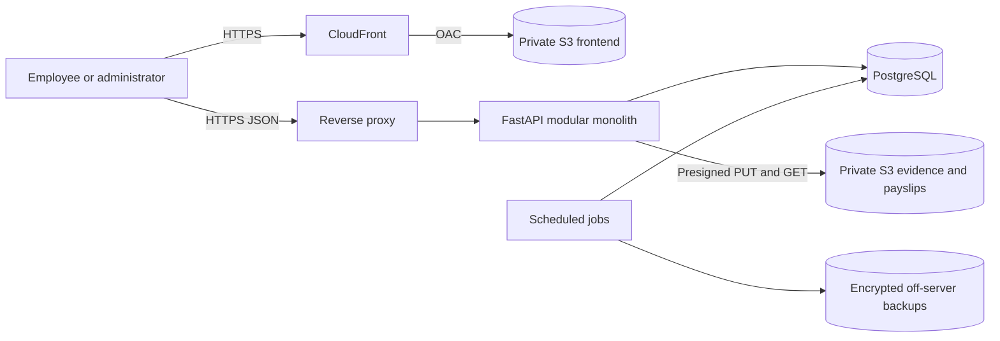

# Target architecture

The final architecture is defined by the supplied SRS and technical-design DOCX.
The current Supabase, Cloudflare and personal-QR implementation is transition input,
not the production target.

## System context

The browser never receives AWS credentials or database access. CloudFront serves
versioned static assets from a private S3 bucket through Origin Access Control.
FastAPI authorizes business requests and brokers narrowly scoped, short-lived object
access. PostgreSQL is private and reachable only by the application and approved
administrative paths.

## Frontend

- React, Vite and TypeScript PWA.
- Role-specific Employee, Store Admin and HR/Payroll experiences.
- System Admin and Auditor interfaces remain narrow and authority-specific.
- Controlled service-worker caching for the application shell and immutable assets.
- Never cache authenticated API responses, attendance photos or payslips.
- Accessible responsive behavior beginning at 360 px.

Existing React components, tokens and responsive layouts may be reused after their
roles and service calls are reconciled with the target contracts. Provider-specific
Supabase clients and personal-QR workflows are replaced.

## API and domains

FastAPI is a modular monolith with these domains:

- `identity`: users, sessions, roles, scopes and audit context.
- `workforce`: organizations, stores, employees and pay-profile references.
- `scheduling`: shifts, assignments, holidays and approved leave inputs.
- `attendance`: store QR challenges, uploads, events, daily summaries and corrections.
- `payroll`: periods, rules, snapshots, calculations, approval, lock and reversal.
- `documents`: object intents, retention, payslip generation and signed access.
- `reporting`: scoped CSV exports and reconciliation.
- `operations`: health, readiness, jobs, backups, metrics and structured logs.

Routers validate transport schemas. Services enforce business rules and authority.
Repositories perform scoped persistence. No router or repository may accept browser-
supplied organization, role or approval authority as trusted fact.

## Data and transactions

- SQLAlchemy 2 and Alembic manage the target PostgreSQL schema.
- Store timestamps in UTC and retain the applicable store IANA time zone.
- Use `NUMERIC`/`Decimal` for all monetary values.
- Raw attendance events, corrections, payroll snapshots and audit events are
  append-only.
- Attendance mutations use idempotency keys and transactional state validation.
- Payroll approval locks the selected version. A later correction creates a reversal
  or a new run; it never edits the locked run.

## Attendance flow

1. An authorized Store Admin requests a short-lived store QR challenge.
2. The server signs a random challenge containing store and expiry context.
3. An Employee requests a constrained private-photo upload intent.
4. The browser uploads directly to private S3 using the presigned operation.
5. The Employee submits the event with an idempotency key and QR/photo references.
6. FastAPI verifies identity, store scope, challenge signature, expiry, replay,
   photo metadata, shift and current in/out state.
7. PostgreSQL commits the server timestamp, raw event and audit event atomically.

Location accuracy and device/browser metadata may be retained as optional evidence
only under the approved privacy policy. They never replace authentication or server
authority.

## Payroll flow

1. HR defines a pay period and selects approved effective-dated configuration.
2. The service reads locked attendance and blocks unresolved exceptions by default.
3. The engine calculates with `Decimal`, stores input snapshots and an input hash,
   and reconciles totals.
4. An authorized approver validates and locks the run transactionally.
5. Payslips are generated into private storage and remain hidden until release.
6. Employees obtain only their own released payslip through expiring signed access.

Until SRS decisions P-01 through P-10 are approved, every result remains
`Draft - Not for payment`.

## Transition boundary

The existing repository must first receive a requirement-to-code trace. Each current
asset is classified as reuse, adapt, replace, archive or remove. Private data is not
moved automatically. A clean target database is preferred for the pilot unless the
owner approves a migration design, reconciliation procedure and rollback plan.
