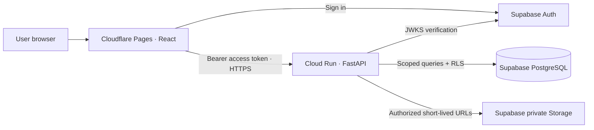

# Architecture

## Current implementation and boundaries

The public React site, login interface, isolated synthetic previews, and FastAPI
health/session boundary run locally. Live workforce APIs and persistent business
workflows are **not implemented**. Authentication now uses Supabase Auth plus the
RLS-protected `current_workspace()` RPC. The optional FastAPI membership adapter
calls the same RPC using a verified caller JWT. Missing configuration or assignment
is denied. Live activation awaits project setup. No API returns demo data.



The frontend was reported live at `https://snr-nest.pages.dev`. Google Cloud Run is
paused; the selected Supabase project is `emvppphhkmbpgqduikup`. The authentication
path can run without Cloud Run. An unconfigured/unassigned install grants no private session.
Development `/preview/*` routes import synthetic fixtures only in Vite development
mode. The production route table and bundle omit those imports. The normal `/me`,
`/team`, and `/hr` routes always use the auth gate.

## Request and authentication flow

1. Supabase receives email/password directly over HTTPS. No password reaches our API.
2. The SDK obtains an access token; Auth `getUser` verifies identity against Supabase.
3. With the default `supabase` session source, `current_workspace()` executes in
   PostgreSQL as the authenticated caller under RLS. It accepts no identity/role/org
   arguments and returns only that user's active database assignment. Zero/multiple
   active assignments are denied; no first-user promotion or tenant auto-selection.
4. With explicit `api` source, FastAPI first verifies the asymmetric JWT's issuer,
   audience, expiry and signature, then calls the same RPC with the user's token.
   No service-role key or bypass of RLS is used. Returned user IDs must match.
5. Only a server-confirmed workspace opens. The SDK stores credentials in tab-scoped
   sessionStorage, rechecks membership on restoration/token refresh, and clears
   local credentials on logout. User metadata never determines permissions.

The default path is browser → Supabase Auth/PostgREST → PostgreSQL RLS. Supabase is
the server enforcing authorization; UI state is not an authority. FastAPI remains
the planned business API layer. This hosting-independent auth decision is recorded
in `DECISIONS.md`; no sensitive workforce mutations were moved into browser code.

No request accepts a browser-supplied organization or role as authority. Organization
selection, if later needed, must be checked against memberships. Auditor and owner
remain distinct roles without HR inheritance. See `SECURITY.md` for the matrix.

## Domain boundaries and data

Auth owns identities/memberships. Employees owns scoped profiles. Shifts owns site
and shift assignments. Attendance owns append-only punches. Corrections owns
requests/recommendations/final decisions. Documents owns private metadata and access
policy. Reports exposes approved projections, never unrestricted raw access.
Each module has a boundary document; only health and the session interface are routed.

PostgreSQL organizations are the tenant boundary; composite tenant foreign keys
prevent accidental cross-organization references. RLS is enabled on every application
table. Initial policies allow narrowly scoped self/team/HR reads; browser writes are
denied. The draft migration is not applied automatically. Production integration needs
transactional service policies/functions and a scoped database adapter.

## Attendance and review workflow (planned)

```mermaid
sequenceDiagram
  participant E as Employee
  participant A as API
  participant S as Supervisor
  participant H as HR
  E->>A: Punch + idempotency key
  A->>A: Verify identity, site/shift, state; timestamp on server
  A->>A: Append attendance event (no overwrite)
  E->>A: Request correction + reason/evidence
  S->>A: Recommend or flag within assigned team
  H->>A: Final decision within organizational scope
  A->>A: Atomically append approval, correction, audit events
```

Clocking, recommendations and approval currently work **only in local preview state**
and reset on refresh. The server must later implement ordering, deduplication,
concurrency control, self-approval restrictions and audited final authority.

## Files, logging, and operations

Sensitive files belong in private Storage buckets. The server checks purpose, owner,
organization, media type/size, malware scanning outcome and retention before issuing
short-lived signed access. No public document URLs or biometric processing.
No storage bucket is provisioned by the foundation.

FastAPI returns a consistent error envelope and request ID, emits JSON request logs
(path/status/duration, no credentials or request bodies), restricts CORS, and adds
security/cache headers. Durable audit events are separate from operational logs and
must be written in the same transaction as sensitive changes.

Frontend builds are static. Cloud Run is stateless with an injected port, non-root
container and health endpoint. Secrets stay server-side in managed configuration.
See `DEPLOYMENT.md` and `RUNBOOK.md`. CORS and robots directives are not authorization.

## Tradeoffs

This foundation prioritizes a polished, testable interface and fail-closed integration
over speculative business policy. No payroll, leave calculations, background workers,
PWA, or real attendance processing yet. Real authorization, database integration,
consent, retention and organization policies must be agreed before private data goes live.
