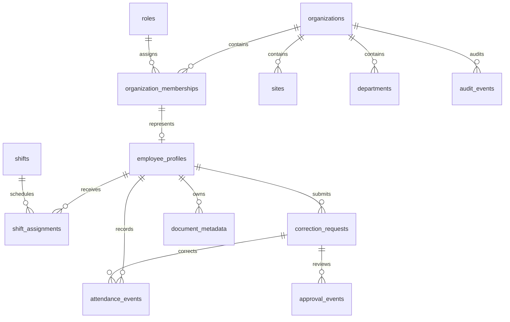

# Data model

`supabase/migrations/202611050001_foundation.sql` defines the reviewed foundation.
The owner reported applying authentication setup; coding tests use local fixtures.
`auth.users` is Supabase-owned. All application tenant records reference an
organization; composite foreign keys prevent cross-tenant references.

The second migration adds read-only `current_workspace()` authorization. It returns
one active membership for `auth.uid()` under RLS, including organization/name and
authorized team/site IDs. Zero/multiple memberships are denied. The project owner
assigns verified accounts using scripts in `supabase/setup/`; there is no public
unrestricted role-provisioning function or automatic promotion. An assignment may exist before
an employee profile; that does not grant attendance mutation capabilities.

| Entity                     | Key details                                                                    |
| -------------------------- | ------------------------------------------------------------------------------ |
| organizations              | Tenant name and default IANA time zone                                         |
| roles                      | Employee, supervisor, HR, security auditor, system owner; no inheritance       |
| organization_memberships   | Auth user, organization, one current role, active flag                         |
| employee_profiles          | Minimal display/directory fields; no legal identity/payroll data               |
| sites / departments        | Organizational scope; each employee has one of each initially                  |
| supervisor_assignments     | Supervisor, department and site intersection                                   |
| shifts / shift_assignments | Local times, IANA zone, effective dates                                        |
| attendance_events          | Server recorded timestamp, occurrence, actor, idempotency key, correction link |
| correction_requests        | Employee's proposed time and reason, append-only                               |
| approval_events            | Recommendation/flag or one final approve/reject decision, actor/note           |
| audit_events               | Minimal structured action/subject/request metadata, no credentials             |
| document_metadata          | Private file description and owner; no public URL/storage path                 |

Raw events never change. Normal punches must use server timestamps; only an approved
correction event may have a historical occurrence time, with its own server-recorded
timestamp. A derived attendance projection will reconcile original and correction
events. Do not treat UI history as a stored source of truth.

Direct browser table writes are denied. Approval status is derived from final events rather
than a mutable request column. Unique idempotency keys and final decision constraints
support, but do not replace, transactional state enforcement. Request retry payload
hashes, actor-role checks, overlap prevention and time-zone handling remain API work.

The third migration adds HR-authorized setup/profile transactions. HR can link a
confirmed Auth account as Employee or Supervisor, with explicit department/site
and account access. It cannot modify protected roles or repurpose cross-tenant
accounts. Each save appends audit history and checks record versions; membership
versions also catch owner-made access changes. A supervisor's single scope is
updated atomically with its profile; inactivity disables membership. Multi-scope
edits are blocked. The directory returns authorized records, 20 per page, with
literal name/number search and HR-only account emails. `is_self` identifies the
caller's profile even if cached navigation has an old role.

The initial model treats an HR
membership as the entire authorized organization; narrower HR site scopes require an
additional reviewed assignment model. Auditor/owner have no HR data inheritance.
Self/team shift/site read projections and document policies remain intentionally
incomplete. The API adapter must handle these explicitly, never disable RLS.

Private Storage needs a separate reviewed bucket/path mapping, scanning, MIME/size
validation, access logs, retention and deletion policy. No live migration, seed data
or bucket changes have been performed by this coding task. See `supabase/policies/README.md`.
